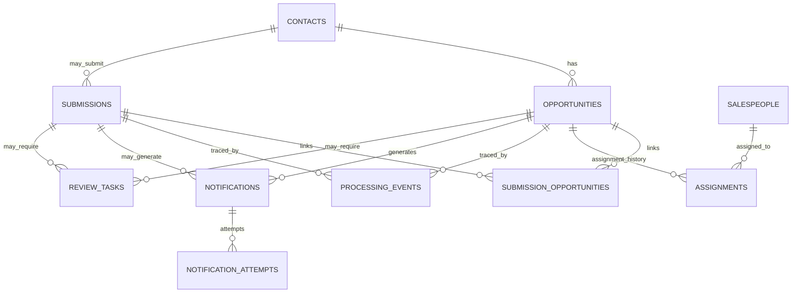

# Data Model — Lead Management & Sales Follow-up Automation

**Project ID:** WA-001  
**Document ID:** DATA-001  
**Version:** 0.1.0  
**Status:** Proposed design — not implemented  
**Scenario:** Fictional B2B SaaS company, ApexFlow Solutions  
**Last updated:** 2026-10-24

> This is a logical and preliminary PostgreSQL physical design for the MVP. It describes intended tables and integrity rules; it is not a claim that migrations, database tables, workflows, or tests exist. All development/demo records will be synthetic.

## 1. Objectives and boundaries

The database must preserve business facts independently of n8n execution history, distinguish submission identity from contact identity and opportunity identity, support safe concurrent intake and recovery, and record communication outcomes without duplicating side effects.

**Primary store:** PostgreSQL. **Orchestration:** n8n. PostgreSQL is authoritative for durable business state; n8n execution records are diagnostic, not the source of truth.

MVP entities:
1. `submissions` — one inbound event identified by source + stable submission key.
2. `contacts` — one person/contact identity, possibly with multiple opportunities.
3. `opportunities` — one distinct business inquiry.
4. `submission_opportunities` — explicit link between submissions and opportunities.
5. `salespeople` — configurable assignment candidates.
6. `assignments` — historical assignment decisions.
7. `notifications` — durable communication intent/outbox.
8. `notification_attempts` — each delivery attempt and its result.
9. `processing_events` — append-only sanitized audit trail.
10. `review_tasks` — human action required for ambiguity, unavailable assignment, or uncertain delivery.

An `interactions` table is reserved for later inbound replies and substantive communications. MVP acknowledgements are represented by `notifications`.

## 2. Entity relationship diagram

Links are optional at intake: an invalid submission might never have a contact or opportunity; an ambiguous submission may remain unlinked until review.

## 3. Field-level schema proposal

Use PostgreSQL `uuid` primary keys, `timestamptz` in UTC, and `text` for human-readable identifiers unless a length constraint is necessary. Use application-generated UUIDs or PostgreSQL `gen_random_uuid()`. Store timestamps as UTC and render in the user's locale at the UI boundary.

### 3.1 `submissions`

| Column | Type | Constraint / meaning |
|---|---|---|
| `id` | uuid | PK |
| `source` | text | NOT NULL; e.g. `website_form` |
| `source_event_key` | text | NOT NULL; stable within source; unique with source |
| `payload_fingerprint` | text | NOT NULL; canonicalized content hash for collision/mismatch detection, not primary identity |
| `contact_id` | uuid | NULL FK to contacts |
| `status` | text | NOT NULL; allowed processing states |
| `correlation_id` | uuid | NOT NULL; traceable across components |
| `received_at` | timestamptz | NOT NULL |
| `processed_at` | timestamptz | NULL |
| `error_code` | text | NULL; sanitized category |
| `schema_version` | integer | NOT NULL; input contract version |

**Unique:** `(source, source_event_key)`. The intake contract should require a stable key for the first MVP. If a source cannot supply one, its ingestion strategy requires a separate documented design; do not use email address as the event key. A replay with the same key but a different fingerprint is an integrity conflict for review, not a silent overwrite.

### 3.2 `contacts`

| Column | Type | Constraint / meaning |
|---|---|---|
| `id` | uuid | PK |
| `display_name` | text | NULL |
| `company_name` | text | NULL |
| `email` | text | NULL |
| `email_normalized` | text | NULL |
| `phone` | text | NULL |
| `phone_normalized` | text | NULL; canonical format when confidently parseable |
| `created_at` / `updated_at` | timestamptz | NOT NULL |

At least one usable contact channel is required for an actionable contact under the proposed MVP intake policy. **Do not automatically place a global unique constraint on normalized email or phone**: shared addresses, aliases, formatting issues, and ambiguous identity can make such uniqueness unsafe. Use nonunique lookup indexes and an explicit matching/review policy. More sophisticated contact identifiers can be added later.

### 3.3 `opportunities`

| Column | Type | Constraint / meaning |
|---|---|---|
| `id` | uuid | PK |
| `contact_id` | uuid | NOT NULL FK to contacts |
| `product_interest` | text | NULL |
| `inquiry_text` | text | NULL; access-controlled business content |
| `qualification_status` | text | NOT NULL, separate from lifecycle |
| `lead_score` | integer | NULL until scored |
| `priority` | text | NULL until determined |
| `ruleset_version` | text | NULL until scored |
| `lifecycle_status` | text | NOT NULL; `new`, `assigned`, `in_progress`, `closed_won`, `closed_lost` |
| `assignment_status` | text | NOT NULL; `unassigned`, `assigned`, `review_required` |
| `current_assignee_id` | uuid | NULL FK to salespeople; convenience pointer |
| `created_at` / `updated_at` | timestamptz | NOT NULL |

A contact may have many opportunities. Never deduplicate opportunities solely by contact email. The inquiry text is not an AI-generated summary. Business status and notification status are independent.

### 3.4 `submission_opportunities`

| Column | Type | Constraint / meaning |
|---|---|---|
| `submission_id` | uuid | FK to submissions |
| `opportunity_id` | uuid | FK to opportunities |
| `link_reason` | text | NOT NULL; `new_inquiry`, `matched_existing`, `review_resolved` |
| `linked_at` | timestamptz | NOT NULL |

Composite PK `(submission_id, opportunity_id)`. MVP policy: a resolved submission links to at most one opportunity, enforced by a unique constraint on `submission_id`; an opportunity can have multiple submissions. Unresolved submissions have no link until reviewed. If later multi-opportunity submissions are supported, revisit this constraint through a migration.

### 3.5 `salespeople`

| Column | Type | Constraint / meaning |
|---|---|---|
| `id` | uuid | PK |
| `display_name` | text | NOT NULL |
| `work_email` | text | NOT NULL, unique normalized address |
| `is_active` | boolean | NOT NULL |
| `is_available` | boolean | NOT NULL |
| `supported_products` | text[] | NOT NULL default empty; simple MVP eligibility configuration |
| `created_at` / `updated_at` | timestamptz | NOT NULL |

Availability is a manually configured MVP flag, **not** a real leave/calendar integration. Assignment eligibility and active-workload definition require finalized business rules.

### 3.6 `assignments`

| Column | Type | Constraint / meaning |
|---|---|---|
| `id` | uuid | PK |
| `opportunity_id` | uuid | NOT NULL FK |
| `salesperson_id` | uuid | NOT NULL FK |
| `assigned_at` | timestamptz | NOT NULL |
| `ended_at` | timestamptz | NULL; active assignment |
| `reason_code` | text | NOT NULL |
| `policy_version` | text | NOT NULL |
| `actor_type` | text | NOT NULL; `system` or `human` |

Use a partial unique index on `(opportunity_id) WHERE ended_at IS NULL` to allow **at most one active assignment per opportunity**. Update `opportunities.current_assignee_id` and `assignment_status` in the same transaction as assignment history. Do not overwrite historical assignments.

### 3.7 `notifications` (transactional outbox)

| Column | Type | Constraint / meaning |
|---|---|---|
| `id` | uuid | PK |
| `submission_id` | uuid | NULL FK |
| `opportunity_id` | uuid | NULL FK |
| `notification_type` | text | NOT NULL; e.g. `acknowledgement`, `assignment_alert`, `review_alert` |
| `recipient_ref` | text | NOT NULL; restricted recipient reference or address |
| `template_version` | text | NOT NULL |
| `dedupe_key` | text | NOT NULL UNIQUE; stable business effect identifier |
| `status` | text | NOT NULL; pending/sending/accepted/failed/unknown/cancelled |
| `attempt_count` | integer | NOT NULL DEFAULT 0 |
| `next_attempt_at` | timestamptz | NULL |
| `locked_until` | timestamptz | NULL; claim lease for workers |
| `provider_message_id` | text | NULL |
| `created_at` / `updated_at` | timestamptz | NOT NULL |

This is an **outbox**: communication intent is committed to PostgreSQL before a worker/n8n workflow sends the message. A unique `dedupe_key` prevents creating duplicate notification intents when an intake execution is replayed. It does **not** guarantee that the external provider delivers exactly once. For assignment alerts, the dedupe key must include the assignment ID so a legitimate reassignment can produce a new alert. For acknowledgements, it should identify the relevant submission and template purpose.

For worker concurrency, atomically claim due pending/retryable notifications (for example with `FOR UPDATE SKIP LOCKED` and a lease), and recheck state before sending. **Never automatically resend an `outcome_unknown` notification without provider reconciliation or explicit operator action.**

### 3.8 `notification_attempts`

| Column | Type | Constraint / meaning |
|---|---|---|
| `id` | uuid | PK |
| `notification_id` | uuid | NOT NULL FK |
| `attempt_number` | integer | NOT NULL |
| `started_at` / `finished_at` | timestamptz | started NOT NULL; finished NULL until complete |
| `outcome` | text | `accepted`, `retryable_failure`, `permanent_failure`, `unknown` |
| `provider_status_code` | integer | NULL |
| `provider_request_id` | text | NULL |
| `error_category` | text | NULL; sanitized |
| `retry_after` | timestamptz | NULL |

Unique `(notification_id, attempt_number)`. Attempt rows are append-only after completion; record a new row for each new attempt. Do not store raw credentials, authorization headers, or entire provider responses.

### 3.9 `processing_events`

| Column | Type | Constraint / meaning |
|---|---|---|
| `id` | uuid | PK |
| `submission_id` | uuid | NULL FK |
| `opportunity_id` | uuid | NULL FK |
| `correlation_id` | uuid | NOT NULL |
| `event_type` | text | NOT NULL |
| `stage` | text | NOT NULL |
| `from_status` / `to_status` | text | NULL |
| `reason_code` | text | NULL |
| `actor_type` | text | NOT NULL |
| `occurred_at` | timestamptz | NOT NULL |
| `metadata` | jsonb | NOT NULL DEFAULT '{}'::jsonb; allowlisted non-sensitive keys only |

Append-only operational events. At least one of `submission_id` or `opportunity_id` should be present for record-linked events; infrastructure-only incidents may require a separate system-event stream. Event history is not a replacement for strongly constrained current state.

### 3.10 `review_tasks`

| Column | Type | Constraint / meaning |
|---|---|---|
| `id` | uuid | PK |
| `submission_id` | uuid | NULL FK |
| `opportunity_id` | uuid | NULL FK |
| `reason_code` | text | NOT NULL |
| `status` | text | NOT NULL; `open`, `resolved`, `dismissed` |
| `assigned_reviewer_ref` | text | NULL |
| `resolution_code` | text | NULL |
| `resolution_note` | text | NULL; restricted |
| `created_at` / `resolved_at` | timestamptz | created NOT NULL |

At least one of submission or opportunity must be present. For a given reason and record, avoid duplicate *open* tasks with an appropriate partial unique index or transactional conflict policy. Record the human actor and decision in `processing_events`.

## 4. Core invariants and constraints

1. **Event uniqueness:** `UNIQUE (source, source_event_key)`; conflicts return the original submission rather than creating another.
2. **Event-key mismatch:** same key with different canonical payload fingerprint triggers review/integrity error.
3. **Contact is not opportunity:** one contact can own multiple opportunities; email is not an opportunity identifier.
4. **Resolved submission cardinality:** at most one opportunity per submission in MVP; zero until resolved.
5. **Single active assignee:** at most one `assignments` row per opportunity where `ended_at IS NULL`.
6. **Assignment consistency:** active assignment history and `current_assignee_id` must agree, maintained transactionally.
7. **Notification intent uniqueness:** `UNIQUE (dedupe_key)` for each intended external business effect.
8. **Attempt uniqueness:** `UNIQUE (notification_id, attempt_number)`; counters cannot be negative.
9. **No orphaned children:** foreign keys enforce references; do not cascade-delete operational evidence accidentally.
10. **State validation:** use `CHECK` constraints or controlled reference tables for valid state values and score ranges after policy is finalized.
11. **Time consistency:** `ended_at >= assigned_at`, `resolved_at >= created_at`, and other applicable timestamp checks.
12. **No implicit success:** opportunity/assignment success cannot be inferred from `notifications.status` or n8n execution success.

## 5. Transaction boundaries and concurrency

### T1 — Intake registration
Validate the request outside the transaction. In a short database transaction, insert the submission with its stable source key and fingerprint. On uniqueness conflict, fetch the existing row, compare fingerprints, and return the known status or flag the mismatch. A concurrent request must not create a second submission.

**Important:** A database outage before T1 commits means the intake is not durably accepted. The HTTP response must indicate retryability rather than falsely claiming receipt.

### T2 — Identity resolution and opportunity creation/link
Within a transaction, safely resolve or create the contact and opportunity and link the submission. If matching is ambiguous, persist a review task instead. Where concurrent requests might create the same contact/opportunity, use documented serialization/advisory locking or an explicit identity-claim design; nonunique email lookup alone cannot guarantee deduplication. The first MVP may conservatively send uncertain cases to review.

### T3 — Qualification and assignment
Update qualification fields, create or end assignment history, update the current assignee, and append a processing event atomically. Lock the opportunity row before changing its active assignment. If no salesperson is eligible, create a review task instead of manufacturing an assignment. A workload calculation may need serialization or a documented eventual-consistency tolerance to avoid simultaneous over-assignment.

### T4 — Outbox creation
Insert intended notifications in the **same transaction as the state change that authorizes them**, or as an idempotent transactional continuation after a previously committed business step. Use unique dedupe keys. A crash after commit must leave a durable pending notification; a crash before commit must not leave a phantom notification.

### T5 — Delivery claim and outcome
A sender claims one pending notification with a short lease, creates an attempt, calls the provider outside the database transaction, then records the result in a new transaction. Claiming and external sending cannot be one ACID transaction. If the sender crashes after provider acceptance but before result persistence, classify the outcome as **unknown** after lease expiry unless provider status/idempotency proves otherwise. Do not automatically treat an expired lease as a safe resend.

### T6 — Review resolution / recovery
A reviewer or operator performs a documented state transition in a transaction with a processing event. Resume only the incomplete step; never rerun all prior side effects indiscriminately.

## 6. Indexes and query patterns

Proposed initial indexes:

- `submissions (source, source_event_key)` UNIQUE.
- `submissions (status, received_at)` for work queues.
- `contacts (email_normalized)` and `contacts (phone_normalized)` nonunique lookup indexes.
- `opportunities (contact_id, created_at DESC)` for inquiry history.
- `opportunities (assignment_status, priority, created_at)` for review/assignment queue.
- `submission_opportunities (submission_id)` UNIQUE in MVP.
- `assignments (opportunity_id) WHERE ended_at IS NULL` UNIQUE partial index.
- `assignments (salesperson_id, ended_at)` for active workload.
- `notifications (dedupe_key)` UNIQUE.
- `notifications (next_attempt_at, created_at) WHERE status IN ('pending','failed_retryable')` for outbox claims.
- `notification_attempts (notification_id, attempt_number)` UNIQUE.
- `processing_events (correlation_id, occurred_at)` and `processing_events (opportunity_id, occurred_at)`.
- `review_tasks (status, created_at)` for human-review queues.

Index selection will be validated against actual queries; additional indexes increase write cost.

## 7. Worked examples (synthetic)

**Example A — Same event replay:** Website sends source `website_form`, key `form-1001`. First request creates submission S1, contact C1, opportunity O1, and pending acknowledgement N1. The same key arrives again. The unique constraint returns S1; N1 is not recreated and O2 is not created.

**Example B — Same person, new need:** The same contact later submits key `form-1002` asking for a different product. Create S2, link C1, and create O2 if the inquiry is distinct. Same email does not collapse O1 and O2.

**Example C — Notification failure:** O1 is assigned to salesperson A1. The assignment alert N2 fails transiently. O1 and its assignment remain intact; N2 records failure and a bounded retry. A later retry must not recreate O1 or A1.

**Example D — Unknown provider outcome:** N1 is sent, but the provider response times out. Record `outcome_unknown`; require provider reconciliation or operator decision before any resend.

**Example E — No eligible salesperson:** Opportunity O3 remains `unassigned`; a review task is created. No assignment-success notification is sent.

## 8. Privacy, lifecycle, and migration considerations

- Restrict access to personal contact fields, inquiry text, recipient addresses, and review notes. Use least-privilege database roles and encrypted connections where applicable.
- Avoid raw payload storage by default. If source payload preservation is needed, document the business reason, access controls, redaction, and retention policy.
- Never put secrets or raw authentication headers in `processing_events.metadata` or notification-attempt records.
- Retention periods, deletion requests, backup handling, and jurisdiction-specific obligations remain policy decisions. Avoid premature `ON DELETE CASCADE` rules on audit/history tables.
- Schema changes should use versioned migrations; never edit production tables manually as the sole change record.
- Design for later CRM external IDs, inbound interactions, consent records, and follow-up scheduling without claiming these exist in the MVP.

## 9. Design decisions requiring confirmation

| Decision | Proposed MVP default | Status |
|---|---|---|
| Primary database | PostgreSQL | Proposed |
| ID type | UUID | Proposed |
| Time storage | `timestamptz` UTC | Proposed |
| Submission identity | Source + mandatory stable event key | Proposed; source contract must support it |
| Contact matching | Conservative, nonunique lookup + review on ambiguity | Proposed |
| Opportunity matching | Distinct inquiry, no email-only dedupe | Proposed; exact criteria open |
| Active assignment | One per opportunity, history preserved | Proposed |
| Message delivery | Transactional outbox + attempt history | Proposed |
| Message retry | Bounded, classified; unknown outcomes require reconciliation | Proposed |
| Data retention | Policy-driven, not arbitrary universal duration | Open |
| Exact scoring and assignment policy | Versioned deterministic rules | Open |
| Notification provider / idempotency capabilities | To be selected | Open |
| Database access boundary | Prefer controlled parameterized SQL/service operations, not unrestricted workflow writes | Open architecture decision |

## 10. Acceptance checks for the future implementation

- Concurrent inserts with the same `(source, source_event_key)` yield exactly one submission.
- Same key with different payload fingerprint is not silently treated as a harmless replay.
- One contact can have two opportunities.
- Ambiguous identity does not trigger an automatic merge.
- Two concurrent assignments cannot leave two active assignment rows for one opportunity.
- Notification outbox intent exists after a committed assignment even when the provider is unavailable.
- Replaying processing cannot insert a second notification with the same dedupe key.
- Notification failure does not roll back an already committed opportunity.
- Timeout-after-send does not automatically cause a second send.
- Processing events support tracing from submission to opportunity to notification.
- Sensitive fields and credentials do not appear in audit metadata or error output.
- Database migrations can create and roll back the schema in a disposable development environment.

## 11. Traceability and next milestone

This design implements the *planned* data responsibilities behind FR-004–FR-008 (identity/persistence), FR-009–FR-017 (qualification/assignment), FR-018–FR-022 (communications), and FR-026–FR-027 (operational visibility), as elaborated in `docs/process-design.md`.

**Next:** Architecture decision record and implementation blueprint: select the n8n-to-PostgreSQL boundary, define intake response semantics, finalize the minimum payload contract and business rules, then create versioned SQL migrations and integration tests. Do not begin provider messaging before the outbox and recovery semantics are designed.
