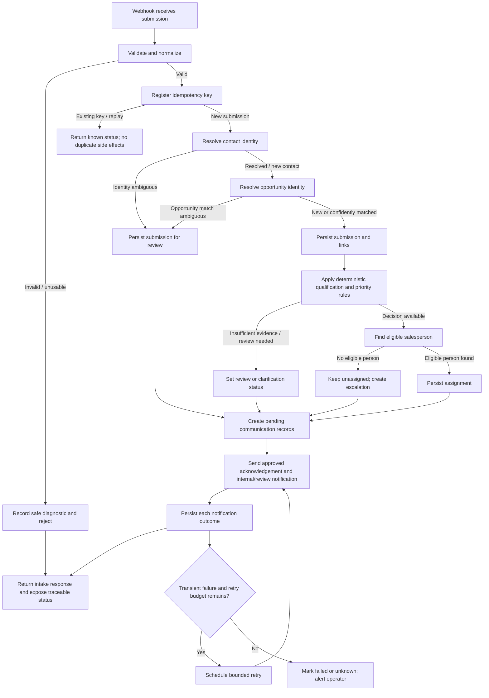

# Process Design — Lead Management & Sales Follow-up Automation

**Project ID:** WA-001  
**Document ID:** PROC-001  
**Version:** 0.1.0  
**Status:** Draft for review  
**Scenario:** Fictional B2B SaaS company — ApexFlow Solutions  
**Last updated:** 2026-10-24

> This document defines the intended MVP business process. It is a design baseline, not evidence that the process has been implemented or tested. All examples and test data must be synthetic.

## 1. Purpose and design principles

Define how an inbound lead submission moves through the system, including normal processing, duplicates, incomplete data, integration failures, and human intervention. This process design bridges the requirements specification and the technical architecture.

Principles:

1. **Persist before external side effects.** Do not send customer or internal messages before the submission and its processing state have been durably recorded.
2. **Separate business entities and states.** A submission, contact, opportunity, workflow execution, assignment, and notification are related but are not the same record or status.
3. **Idempotent processing.** Replaying the same logical submission must not create duplicate business records or repeat already-completed side effects.
4. **Fail visibly, not silently.** Record a recoverable or permanent failure, its stage, and the next action.
5. **Use deterministic MVP decisions.** Qualification and priority use documented rules. AI-assisted qualification is out of scope for the initial MVP.
6. **Use human review for ambiguity.** Do not automatically merge uncertain opportunities or invent missing customer requirements.
7. **Minimize personal data in logs and notifications.** Store only what the business process needs; never log credentials or API keys.

## 2. MVP scope

### Included

- Receive one defined webhook payload.
- Validate and normalize fields.
- Create a traceable submission record and idempotency key.
- Match an existing contact separately from matching an existing opportunity.
- Persist a new opportunity or route an ambiguous match for review.
- Apply configurable deterministic qualification/priority rules.
- Select an eligible salesperson using a basic documented assignment policy.
- Send an approved acknowledgement when a usable contact channel and applicable consent/policy permit it.
- Send an internal assignment notification.
- Track customer-message and internal-notification outcomes independently.
- Record stage transitions, errors, and recovery status.
- Support bounded retries for classified transient notification failures.

### Excluded from the first MVP

AI-based interpretation or drafting; CRM synchronization; inbound email/reply monitoring; automated multi-step follow-up campaigns; calendar/leave-system integration; advanced territory routing; management dashboards; and coordinated deletion across third-party systems. These are later enhancements and must not be implied by the MVP.

## 3. Roles and systems

| Role / system | Responsibility in this process |
|---|---|
| Prospect / source form | Submits an inquiry and, where supported, a stable source submission ID |
| Intake webhook | Accepts the payload under a documented contract |
| Workflow orchestrator (n8n) | Coordinates validation, matching, qualification, assignment, communication, and error paths |
| PostgreSQL | System of record for submissions, contacts, opportunities, assignments, notification attempts, and processing events |
| Email / notification provider | Delivers approved external acknowledgement and internal assignment notification |
| Salesperson | Owns the assigned opportunity and takes substantive sales action |
| Sales manager / reviewer | Resolves ambiguous matches, unavailable-assignee cases, and escalated failures |
| Automation operator | Investigates workflow/infrastructure errors and retries safe operations |

The database is the source of truth for business state. A successful n8n execution alone does not prove that the lead was successfully assigned or that a message was delivered.

## 4. End-to-end process

### 4.1 Normal path

1. **Receive request.** The webhook receives the payload and assigns a correlation/execution identifier. If the source supplies a stable submission ID or idempotency key, retain it. If not, use a documented fallback policy; do not silently claim perfect replay detection without a stable key.
2. **Validate contract.** Check payload shape, supported field types, field lengths, and required contact/purpose rules. Normalize safe comparison fields (for example, trim whitespace and normalize email case). Preserve the original submitted value where needed for audit or display.
3. **Handle invalid input.** Reject malformed or unusable input with a documented response and a minimal diagnostic record where safe. Do not proceed to qualification, assignment, or customer communication.
4. **Check submission idempotency.** Attempt to register the submission using a database uniqueness constraint on the chosen idempotency key. If it is a replay, return the known outcome or processing status and do not repeat completed side effects. Concurrent replays must be resolved by the database constraint, not only by a workflow-level “check then insert.”
5. **Resolve contact identity.** Match using normalized, available contact identifiers. A matching email or phone can suggest the same contact, but is not proof that the inquiry is the same opportunity. If identity is uncertain, retain the submission and route it for review rather than merging records automatically.
6. **Resolve opportunity identity.** Apply the documented opportunity-match policy using available evidence (such as source reference, product/service, and inquiry context). A repeated event is handled by idempotency. A known contact with a distinct requirement may have a new opportunity. An ambiguous match is marked for human review.
7. **Persist the business record.** In a transaction, store the submission and the relevant contact/opportunity links and initial processing status. Enforce referential integrity and uniqueness constraints. Do not rely on a later notification to prove that persistence succeeded.
8. **Qualify and prioritize.** Apply versioned deterministic rules to the available evidence. Keep qualification outcome, operational priority, and assignment as separate fields/decisions. If required evidence is missing or the result falls into an uncertainty band, mark the record for review/clarification instead of inventing information.
9. **Select an assignee.** Filter the configured salesperson list to eligible and available candidates. Apply the MVP selection policy to the eligible set (for example, lowest active workload, with a deterministic tie-breaker). Record the assignment and the rule/policy version. If no eligible person exists, leave the opportunity unassigned and create a review/escalation task; do not silently assign an unavailable person.
10. **Commit state before messaging.** Persist the qualification, priority, assignment (or review-needed status), and pending communication records before attempting external sends.
11. **Send approved communications.** Send an approved acknowledgement only when the submission is usable and the applicable communication policy permits it. Send an internal notification to the assignee, or a review/escalation notification if no assignee is available. Keep each notification's status independent from the opportunity's status.
12. **Record outcomes.** Store provider outcome, attempt count, timestamps, and a sanitized error category where relevant. A message can be pending, sent/accepted by provider, failed, or in an unknown outcome state; do not equate provider acceptance with confirmed inbox delivery.
13. **Return/record intake outcome.** Return a response consistent with the webhook contract. A response indicating receipt must not imply that all downstream actions succeeded. Expose a correlation ID so an operator can trace the request.
14. **Monitor and recover.** Retry only classified transient failures within configured limits. Permanent failures and exhausted retries become visible operational work. Recovery resumes from the failed stage and must not recreate the lead or resend already-confirmed messages.

### 4.2 Process flow

The diagram is conceptual. The implementation may split the process into multiple n8n workflows so that intake, notification delivery, and recovery can be retried independently.

## 5. Validation and incomplete submissions

Validation must distinguish **invalid** from **valid but incomplete**:

- **Invalid/unusable:** malformed payload, unsupported data types, or no usable contact route when the process requires one. Reject or quarantine according to the intake contract; do not send an acknowledgement.
- **Valid but incomplete:** a usable contact route exists, but optional fields or business context are missing. Store the submission, mark qualification as pending/review-needed, and use an approved clarification template only if the communication policy permits it.
- **Vague but usable:** for example, “We need automation for our business.” Store the customer's wording and mark the information gap. Do not fabricate a business problem, product fit, budget, or summary.

The exact required fields, allowed formats, payload size, and contact/consent rules are open decisions to finalize before implementation.

## 6. Duplicate and identity handling

| Case | Required behavior |
|---|---|
| Same source event / same idempotency key | Treat as replay; do not create another opportunity or repeat completed effects |
| Same contact, clearly distinct inquiry | Create a distinct opportunity linked to the existing contact |
| Same contact, likely same active opportunity | Link the new interaction/submission to the existing opportunity only when documented matching criteria support it |
| Possible match but insufficient evidence | Persist safely and route for human review; do not auto-merge |
| Concurrent duplicate submissions | Let database uniqueness/transaction controls prevent duplicate event registration |
| No stable source ID available | Apply a documented fallback and acknowledge its limitations; do not rely on email alone as an idempotency key |

A workflow-level “search then insert” is insufficient for concurrency safety because two executions may both observe no matching record. Database constraints and conflict handling are required. Idempotency retention must be defined and aligned with the source's replay behavior.

## 7. Qualification, priority, and assignment

### Qualification and priority

- Use transparent, versioned deterministic rules in the MVP.
- Store the resulting score, qualification outcome, priority, and ruleset version separately.
- Define scoring inputs and thresholds in a later business-rules artifact; this document intentionally does not invent numeric weights or thresholds.
- Missing evidence must not automatically mean low commercial value. Route uncertain cases to review or clarification.
- AI-assisted contextual qualification is a later phase and must be evaluated against a labelled synthetic test set before it can influence operational decisions.

### Assignment

1. Build the eligible candidate set from configured active/available salespeople and any required product expertise.
2. If the eligible set is empty, keep the opportunity unassigned and raise a review/escalation.
3. Otherwise, apply the selected workload/rotation policy and deterministic tie-breaker.
4. Persist the assignee, assignment timestamp, assignment reason/policy version, and assignment history.
5. If assignment persistence fails, do not send a success notification claiming assignment is complete.
6. Changes in availability after assignment are not automatically handled in the first MVP unless explicitly added to scope.

## 8. State model

Do not use one overloaded status field for every aspect of the process. Keep at least the following state dimensions.

### Submission processing status

- `received`
- `validation_failed`
- `duplicate_event`
- `processing`
- `needs_review`
- `processed`
- `processing_failed`

### Opportunity status (business lifecycle)

- `new`
- `needs_clarification`
- `qualified`
- `unqualified`
- `assigned`
- `in_progress`
- `closed_won`
- `closed_lost`

These are candidate values, not a finalized state machine. Some statuses may need to be represented as separate fields (for example, qualification outcome versus sales lifecycle); the data-model milestone must finalize this.

### Assignment status

- `unassigned`
- `assigned`
- `review_required`

### Notification status (per notification, not per lead)

- `pending`
- `sending`
- `accepted_by_provider`
- `failed_retryable`
- `failed_permanent`
- `outcome_unknown`
- `cancelled`

### Operational execution status

Record the current stage, start/end timestamps, correlation ID, attempt count, and sanitized error category. A workflow can complete its error-handling branch successfully while a notification remains failed; business state must continue to show that failure.

## 9. Failure handling and recovery

| Failure | Persisted business state | Recovery behavior |
|---|---|---|
| Malformed input | Validation failure where safe to record | Return documented client error; no downstream side effects |
| Database unavailable before durable intake | Intake not confirmed as durably accepted | Return retryable failure; source may retry using the same idempotency key |
| Duplicate key conflict | Existing submission remains authoritative | Fetch/return existing status; do not recreate |
| Ambiguous contact/opportunity match | Review required | Create a review item; no automatic merge |
| Qualification step fails after persistence | Processing incomplete / retryable or review-needed | Resume from qualification stage using persisted record |
| No eligible salesperson | Opportunity remains unassigned | Notify manager/review queue; do not claim assigned |
| Assignment write fails | Assignment not confirmed | Retry safe database operation; do not send assignment-success message |
| Notification provider returns transient error | Lead/opportunity remains persisted; notification marked retryable | Bounded retries with backoff and recorded attempts |
| Invalid recipient or permanent authorization/configuration error | Notification marked permanently failed | Alert operator; correct configuration/recipient before a controlled retry |
| Provider request times out after submission | Notification outcome unknown | Avoid blind resend if duplicate delivery is possible; reconcile provider status or route for operator review |
| Retry budget exhausted | Notification remains failed with final attempt details | Alert operator and expose a recovery action |
| Workflow crashes after send but before recording success | Notification outcome may be unknown | Use provider idempotency/status lookup if supported; otherwise reconcile before resend |
| Error notification also fails | Original error remains recorded | Use independent operational visibility (execution log/health check); do not recurse endlessly through error alerts |

### Retry policy requirements

- Retry only errors classified as transient (for example, temporary network failures, rate limits, and selected server errors).
- Use bounded exponential backoff with jitter where supported; set a maximum attempt count and retry window in configuration.
- Respect provider retry-after instructions when available.
- Do not retry permanent validation/authentication errors without a corrective action.
- Record each attempt and its result. Do not overwrite the original failure with only the latest error.
- Ensure retrying a notification cannot recreate the contact/opportunity.
- Treat timeout-after-send as an unknown outcome, not an assured failure. Exactly-once delivery cannot be promised unless the provider and integration contract support it.

Exact retry values and provider-specific behavior will be set during architecture and implementation.

## 10. Human intervention

Human review is required when:

- Contact or opportunity identity is ambiguous.
- Qualification evidence is insufficient or contradictory.
- No eligible salesperson is available.
- A permanent notification failure needs a configuration or data correction.
- A send operation has an unknown outcome and duplicate delivery is possible.
- A record requires a merge, reassignment, or other action not covered by a deterministic rule.

A review item should include the record/correlation ID, reason, relevant minimum context, available actions, and current status. Manual decisions should be recorded with actor, timestamp, reason, and resulting state. AI-generated substantive sales responses and automatic multi-step follow-ups are out of MVP scope.

## 11. Communication and privacy safeguards

- Customer acknowledgements must use approved, factual templates and must not promise pricing, availability, outcomes, or timelines that are not verified.
- Do not send an acknowledgement for an unusable submission or where applicable communication policy does not permit it.
- Internal notifications should contain only the information needed to act: priority, company/contact reference, relevant inquiry summary or excerpt where necessary, assignee, and a link/reference to the record. Avoid copying full personal details into broad channels.
- Never include credentials, tokens, full request headers, or unnecessary personal data in logs.
- Use synthetic data for demos and automated tests.
- Retention, deletion, consent, and jurisdiction-specific obligations require a separate policy decision; this design does not claim legal compliance.

## 12. Observability and audit trail

For each submission, maintain a traceable chain between correlation ID, submission ID, contact ID, opportunity ID, assignment record, notification records, and workflow execution. Record:

- event/stage name and timestamp;
- state transition and reason code;
- ruleset or policy version used;
- assignment decision and history;
- notification type, recipient reference, attempt count, provider result, and sanitized error category;
- retry scheduling and final outcome;
- human-review decision, actor reference, timestamp, and reason where applicable.

Use structured logs and avoid recording full payloads by default. Alert on actionable conditions such as exhausted retries, persistent infrastructure failure, and unassigned records requiring review. Alerts must not expose secrets or unnecessary customer data.

## 13. Process acceptance scenarios

The implementation must eventually test at least these scenarios:

1. Valid submission is persisted, qualified, assigned if an eligible salesperson exists, and produces traceable communication outcomes.
2. Malformed payload is rejected without creating an opportunity.
3. Missing optional data does not invalidate an otherwise usable submission.
4. Vague but usable inquiry is stored and marked for clarification/review.
5. Replaying the same idempotency key does not create a second opportunity or repeat completed side effects.
6. Concurrent replay attempts cannot create duplicate submission records.
7. Same contact submits a clearly distinct inquiry and receives a separate opportunity.
8. Ambiguous opportunity match is routed for review.
9. No eligible salesperson exists; opportunity remains unassigned and escalation is recorded.
10. Database persistence succeeds but an internal notification fails; the lead remains persisted and notification failure is visible.
11. Transient notification failure is retried within configured limits.
12. Permanent provider error is not blindly retried.
13. Timeout after send is represented as unknown until reconciled.
14. A crash/replay after partial processing resumes safely without duplicating business records or confirmed messages.
15. Logs and notifications do not expose secrets or unnecessary personal data.

## 14. Open decisions for the next milestone

The following must be resolved before implementation:

- Exact webhook payload schema and response semantics.
- Required versus optional fields and applicable communication/consent rules.
- Source submission ID/idempotency-key strategy and retention.
- Contact and opportunity matching rules and review thresholds.
- Deterministic qualification inputs, scoring weights, priority thresholds, and ruleset versioning.
- Salesperson eligibility configuration, workload metric, tie-breaker, and manager escalation route.
- Database entity/state model and transaction boundaries.
- Notification provider, approved templates, provider idempotency/status lookup capabilities, and retry configuration.
- Operational alert destination and minimum audit/log fields.
- Local development, environment, secret management, and test strategy.

## 15. Traceability and next step

This process design elaborates the intake, idempotency, identity matching, deterministic qualification, assignment, communication, outcome tracking, and failure-handling requirements in `docs/requirements.md`.

**Next artifact:** `docs/data-model.md` and a concise architecture decision record. Define entities, relationships, uniqueness constraints, transaction boundaries, state ownership, and the n8n/PostgreSQL integration boundary before building the workflow nodes.
