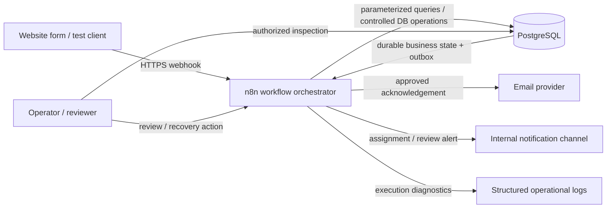

# System Architecture — Lead Management & Sales Follow-up Automation

**Project ID:** WA-001  
**Document ID:** ARCH-001  
**Version:** 0.1.0  
**Status:** Proposed architecture — not implemented  
**Scenario:** Fictional B2B SaaS company, ApexFlow Solutions  
**Last updated:** 2026-10-24

> This is a proposed MVP architecture. It is not evidence that containers, database schemas, workflows, credentials, or integrations have been deployed or tested.

## 1. Architecture goals

The architecture should demonstrate a maintainable, observable lead-processing system using n8n and PostgreSQL, while keeping infrastructure and code proportional to the MVP.

Goals:
- Reliable webhook intake with explicit response semantics.
- PostgreSQL as the durable source of truth.
- Idempotent processing and concurrency-safe database operations.
- Separation of business state from notification delivery.
- Bounded retries and a recoverable transactional outbox.
- Clear workflow boundaries and actionable error visibility.
- Secrets kept outside Git and redacted from logs.
- Repeatable local setup and testable behavior using synthetic data.

Non-goals for the first MVP: microservices, Kubernetes, a custom frontend, an AI qualification service, multi-CRM support, advanced reporting, and production-grade high availability.

## 2. Proposed component architecture

### Components and responsibilities

| Component | Responsibility | Must not own |
|---|---|---|
| Source form / test client | Sends a submission using the published payload contract and stable source event key | Qualification logic or database state |
| n8n intake workflow | Receives the event, validates the envelope, coordinates processing, returns a contract-compliant response | Sole responsibility for data integrity or duplicate prevention |
| PostgreSQL | Stores contacts, opportunities, submissions, assignments, notifications, attempts, review tasks, and processing events | Email delivery or workflow orchestration |
| PostgreSQL constraints and controlled operations | Enforce uniqueness, referential integrity, and atomic multi-row state changes | External API calls |
| n8n notification worker | Claims due outbox records, calls providers, records results, and schedules safe retries | Recreating business records during a retry |
| Email / internal notification provider | Accepts outbound messages and returns provider outcomes/IDs | Being the source of truth for opportunity state |
| Operational monitoring | Surfaces workflow failures, exhausted retries, stale claims, and unresolved review tasks | Replacing durable failure records |
| Operator / reviewer | Resolves ambiguous identity, permanent configuration failures, and unknown message outcomes | Editing records without an auditable reason |

**Initial architecture choice:** use n8n for orchestration and PostgreSQL for state. Keep the boundary explicit: simple reads and updates may use parameterized PostgreSQL node queries; multi-step operations that must be atomic should be implemented as a versioned SQL function or a carefully controlled single transaction invoked by n8n. Do not spread a required database transaction across independent n8n nodes.

A separate FastAPI service is deferred unless requirements reveal a need for a stable public API, complex validation/business logic shared by multiple clients, or a security boundary that cannot be provided adequately by the n8n/database setup.

## 3. Logical workflow boundaries

Split the automation into small workflows with clear inputs and outputs rather than one giant workflow.

### WF-01 — Lead Intake and Registration

**Trigger:** Webhook.  
**Responsibilities:** validate request envelope; require source and stable event key; normalize safe comparison fields; register the submission idempotently; return a response consistent with durable intake status; create or enqueue processing work.

This workflow should not perform long-running email sends before responding. It must not report durable acceptance if the database registration did not commit. Exact synchronous/asynchronous response semantics remain an implementation decision.

### WF-02 — Lead Processing

**Trigger:** explicit processing queue/record or an idempotent continuation after intake registration.  
**Responsibilities:** resolve contact and opportunity conservatively; create/link records; apply deterministic qualification rules; select an eligible salesperson; record assignment or review task; create notification outbox entries.

The core database transition should be atomic where several related rows must agree. An ambiguous match routes to review instead of merging automatically.

### WF-03 — Notification Dispatcher

**Trigger:** schedule/polling trigger in the MVP.  
**Responsibilities:** claim due outbox records atomically; send approved template messages; record each attempt and provider response; schedule bounded retry for classified transient failures; mark permanent or unknown outcomes accurately.

Do not keep a database transaction open while waiting for a provider's network response. Use a short claim transaction/lease, perform the external call, then persist the outcome separately. A timeout after provider acceptance is potentially ambiguous and must not be blindly resent.

### WF-04 — Error and Recovery Handling

**Trigger:** workflow error trigger plus scheduled reconciliation for durable pending work.  
**Responsibilities:** create/retain actionable error events; notify the operator when appropriate; identify stale processing/notification claims; provide controlled retry or review actions.

The error workflow itself can fail. Durable database state and independent execution/health monitoring must remain available so an alert failure does not erase the original error.

### WF-05 — Review Resolution (minimal MVP path)

**Trigger:** an authorized manual action, initially via a documented operator procedure or controlled database/admin interface.  
**Responsibilities:** resolve ambiguous matches, correct invalid configuration, and adjudicate unknown delivery outcomes; record actor, timestamp, reason, and resulting state. Avoid exposing unrestricted database write access to reviewers.

A polished review UI is out of scope for the first MVP.

## 4. Data and integration flow

1. The source submits a payload with a stable source event key.
2. WF-01 validates the request and registers it in PostgreSQL under a unique key.
3. PostgreSQL returns either a newly registered submission or the existing record for a replay.
4. WF-02 processes only incomplete work, resolves identities, and writes business state and outbox intent through controlled operations.
5. WF-03 claims a pending notification using an atomic database operation and lease.
6. The worker calls the provider outside the database transaction.
7. The provider outcome is stored as an attempt and reflected on the notification record.
8. Retryable failures are scheduled; permanent/unknown outcomes are surfaced for controlled recovery.
9. Processing events and correlation IDs connect the source submission to the opportunity, assignment, notification, and recovery history.

The database is the authoritative state. n8n execution history supplements this state and may be pruned according to an explicit operational policy; it must not be the only record of a lead or notification failure.

## 5. API and webhook contract

The initial public interface is a single versioned webhook contract, such as a versioned route/path chosen at implementation time. The payload should include:
- `source`
- `source_event_key` (stable across retries)
- `schema_version`
- contact fields (name, company, email and/or phone as permitted)
- inquiry fields (product interest and message, when available)
- applicable communication preference/consent fields if required by the approved policy

Do not finalize the payload until the requirements/business rules are approved. Never use an email address as the event idempotency key.

Response semantics must distinguish:
- **Accepted and durably registered:** the submission row has committed; downstream processing may still be pending.
- **Duplicate/replay:** the key already exists; return or reference the known processing state without repeating side effects.
- **Client validation failure:** payload does not meet the contract.
- **Retryable service failure:** durable registration could not be confirmed, such as a database outage.

The proposed status codes and response schema are specified in `docs/intake-contract.md`; implementation must still validate them against the deployed n8n version and database transaction boundary. A successful intake response must not imply that qualification, assignment, or email delivery has completed.

## 6. Database access and transaction strategy

- Use PostgreSQL constraints as the final authority for uniqueness and relationships.
- Use parameterized queries; never interpolate user-supplied values into SQL strings.
- Use versioned SQL migrations stored in the repository.
- Keep transactions short. Do not call external services while a transaction is open.
- Implement atomic operations for submission registration, opportunity linking, assignment updates, and outbox creation using database functions or a controlled transaction boundary.
- Use a unique outbox dedupe key for each intended message.
- Claim notifications atomically (for example, with a short lease and `FOR UPDATE SKIP LOCKED` where appropriate).
- Use bounded retries and explicit `outcome_unknown` state for ambiguous provider outcomes.
- Configure a least-privilege database role for n8n; do not use a PostgreSQL superuser credential in workflow connections.
- Do not rely on an n8n node's green execution indicator as proof of business success.

Direct n8n-to-PostgreSQL connectivity is acceptable for this single-system MVP only if credentials, queries, permissions, transaction boundaries, and recovery are controlled. If that proves awkward to test or secure, revisit a thin API/service boundary rather than quietly adding one without justification.

## 7. Security and configuration

- Keep runtime secrets in environment variables or n8n credentials, not in workflow exports, source code, logs, screenshots, or Git.
- Commit only placeholders in `.env.example`.
- Use separate development/test credentials and synthetic data.
- Restrict webhook access where possible using authentication, a secret token, rate limiting, and HTTPS at the deployment boundary. A public unauthenticated webhook is not a production-ready default.
- Restrict database network access to the required services; avoid exposing PostgreSQL to the public internet.
- Use least-privilege credentials and rotate exposed secrets.
- Redact authorization headers, tokens, and unnecessary personal information from error output.
- Limit internal notification content to the minimum required to act.
- Define execution-data retention separately from business-record retention.
- Treat the fictional portfolio demo as a demonstration, not a claim of legal or security certification.

## 8. Deployment topology (local development)

Use Docker Compose for reproducible local development with:
- n8n container;
- PostgreSQL container;
- persistent volumes for PostgreSQL and n8n configuration/data;
- private Compose network for service-to-service traffic;
- health checks and explicit service dependencies where supported;
- environment configuration sourced from an untracked local `.env`;
- versioned SQL migrations and synthetic seed/test data.

Expose only the local ports needed for development. PostgreSQL should be reachable from the host only if local tooling requires it; otherwise keep it internal to the Compose network. Do not expose production credentials or real prospect data in a portfolio demo.

A separate reverse proxy, public domain, TLS configuration, backup strategy, and hardened deployment profile are later deployment tasks, not implied by a local Compose file.

## 9. Observability and operations

Every inbound request should be traceable through:
- correlation ID;
- submission ID;
- opportunity ID, when resolved;
- workflow name and execution ID where available;
- current stage/status and timestamps;
- notification ID and attempt number;
- sanitized error category and next action.

Minimum operational signals:
- intake validation failures and database registration failures;
- processing records stuck beyond a configured time;
- unassigned opportunities needing review;
- pending notifications past their due time;
- retry exhaustion and permanent delivery failures;
- unknown provider outcomes;
- stale worker claims;
- failures in the error-notification path.

The initial MVP may use n8n execution logs plus database queries and an operator alert channel; a metrics dashboard is deferred. Alert messages should contain identifiers and the action needed, not full payloads or secrets.

## 10. Recovery and idempotency rules

- Replaying a submission key returns the existing submission and does not create a second opportunity.
- Re-running processing resumes from persisted state; each stage must be safe to repeat or guarded by a durable state transition.
- Notification retries operate on the existing outbox record, not by rerunning lead intake.
- A notification with a confirmed provider acceptance is not sent again merely because a later workflow step failed.
- A timeout after send remains unknown until reconciled or explicitly adjudicated.
- Expired processing/notification leases require a state check before work is reclaimed.
- Every manual recovery action records actor, time, reason, and outcome.
- If the database is unavailable, do not claim durable acceptance. A source retry must use the same stable event key.

## 11. Testing strategy

Use synthetic test payloads and an isolated development database. The test suite should include:
- valid, malformed, incomplete, and vague payloads;
- sequential and concurrent replays;
- same contact with distinct opportunities;
- ambiguous matching and no eligible salesperson;
- database failure before durable intake;
- failure between persistence and outbox dispatch;
- transient, permanent, and unknown notification outcomes;
- stale worker lease and retry exhaustion;
- safe reprocessing after partial failure;
- secret redaction and access-control checks;
- migrations applied to a clean database and upgraded from the prior schema.

Unit tests should cover pure normalization/scoring/assignment rules; integration tests should exercise PostgreSQL constraints and transaction behavior; workflow tests should validate the n8n path and provider error branches. Only report tests as passing after execution.

## 12. Architecture decisions and open items

**Proposed decisions**
- n8n orchestrates; PostgreSQL owns durable state.
- MVP uses direct n8n-to-PostgreSQL connectivity for simple operations and controlled SQL functions/transactions for atomic multi-row work.
- Notification sending uses a durable outbox and separate attempts table.
- A thin FastAPI service is deferred unless a concrete requirement justifies it.
- Docker Compose is the local development topology.
- AI, CRM, advanced follow-up, and a custom UI are deferred.

**Must be finalized before implementation**
1. Webhook authentication and exact response schema/status codes.
2. Required/optional payload fields and communication policy.
3. SQL migration conventions and supported PostgreSQL/n8n versions.
4. Atomic database functions/queries and transaction contracts.
5. Notification provider and its idempotency/status-reconciliation capabilities.
6. Retry limits, delays, lease duration, and stale-work recovery policy.
7. Assignment eligibility, workload metric, tie-breaker, and escalation destination.
8. Secret storage, database permissions, logging, and execution-data retention.
9. Test commands and automated validation approach.

## 13. Traceability and next milestone

This architecture operationalizes `docs/process-design.md` and `docs/data-model.md` while preserving their open policy decisions.

**Current implementation slice:** migration `001_create_submissions.sql` defines the initial migration ledger and intake submission table. It remains unexecuted until a disposable PostgreSQL development database is available. Next, apply and verify the migration, then test duplicate-key behavior, fingerprint validation, concurrent replay, and failure handling before connecting the webhook.
